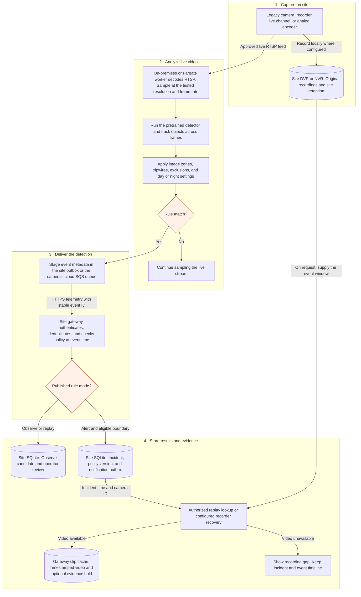

# Global View CCTV from camera to incident storage

Legacy cameras supply video. Global View handles detection, tracks objects across frames, evaluates site rules, and records qualifying incidents. The same analytics run on a customer server or in the cloud. Full-quality recordings stay on the site recorder. A site's bandwidth and cost budget guide compute placement after the stream and worker meet its detection targets.

The arrows show video and metadata flow. The worker initiates the RTSP connection. The gateway or recorder connector requests clips by event time. An analog camera needs an accessible digital channel before Global View can ingest it.

## Requests, records, and evidence

| Step | Request and ownership |
| --- | --- |
| **Open the stream** | The worker pulls a read-only RTSP channel from the camera, DVR, NVR, or encoder. A cloud worker reaches the approved channel over private site routing. A local worker reads the same channel on the site network. FFmpeg decodes and samples images in memory. The browser's live HLS wall is a separate playback path. [Live decoder](../services/camera-gateway/video_analytics/video.py#L13) · [Compute placement](cctv-analytics.md#compute-placement-and-video-access) |
| **Load policy and run inference** | Worker → site gateway `GET /api/cameras/{id}/analytics` for the policy and `POST /api/cameras/{id}/analytics` for heartbeat. Heartbeats include model identity, effective sampling rate, frame age, and pending delivery count. The worker stops reading video when its policy lease expires. The detector and tracker turn sampled frames into rule matches. [Worker loop](../services/camera-gateway/analytics_worker.py#L248) |
| **Deliver an observation** | The worker puts rule matches in a local SQLite outbox or, on Fargate, a per-camera encrypted SQS queue. The worker sends `POST /api/site/telemetry` with the camera ID, event ID, worker timestamp, model fingerprint, rule and policy version, class, score, box, and anonymous track ID. The gateway authenticates the device and placement, deduplicates retries, and checks the published configuration effective when the event occurred. During an SQS interruption the Fargate worker can stage events locally. Unacknowledged staging data can be lost during task replacement. [Telemetry transaction](../services/camera-gateway/site_telemetry.py#L69) · [Cloud recovery](../infra/ecs-cctv/README.md#growth-and-recovery) |
| **Commit and notify** | Observe and replay matches are reviewable. Eligible Alert matches produce an incident scoped to the configured boundary. The gateway commits the observation, incident, and any notification outbox entry together. If a receiver is configured, a background worker sends the signed notification. A delayed event can remain in incident history after the live notification window has passed. [Site evaluation](../services/camera-gateway/site_monitoring.py#L168) · [Notification delivery](../services/camera-gateway/gateway.py#L350) |
| **Retrieve evidence** | The portal relays authorized `GET /streams/{key}/recording.json?at={utcMilliseconds}` and clip requests. Supported recorder connectors can retrieve a bounded event window. The gateway keeps a temporary MP4 copy and accepts an evidence hold when authorized. Recorder recovery can fetch clips asynchronously when configured. Missing or expired media leaves the incident record and its timeline available. [Recording request handler](../services/camera-gateway/gateway.py#L923) · [Clip cache and hold](../services/camera-gateway/axis_archive.py#L206) |

## Quality gates before enabling alerts

| Gate | Acceptance check |
| --- | --- |
| **The source shows the event clearly** | Verify the recorder channel, crop, time alignment, and useful object size on the actual camera. Replay short crossings, night scenes, occlusion, and normal traffic. Increase image detail or sampling if the chosen stream misses critical events. The current Fargate starting size and 4 fps preset are commissioning defaults. Both baseline models missed the crossing in the first labeled 4 fps MEVA fixture. [Labeled entrance tripwire](cctv-analytics.md#score-a-labeled-entrance-tripwire) |
| **The live worker keeps up** | Measure effective inference rate and frame age at the planned concurrent camera count. The live buffer keeps the newest frame and may skip older frames when a worker is busy. Test reconnects and a transient buffer backlog. Track video gaps, skipped samples, and delivery backlog separately so operators can see where coverage was lost. Frame age, inference rate, and pending count are available today. A dedicated skipped-sample count is a proposed addition. [Live frame buffer](../services/camera-gateway/video_analytics/video.py#L56) · [Worker heartbeat](../services/camera-gateway/analytics_worker.py#L290) |
| **The rule is reliable** | Start with the pretrained model in Observe mode. Review detections and independently label ordinary footage to find missed events. Compare event recall, false alerts per camera-hour, and capture-to-incident delay against customer-approved targets. Publish a qualified rule with its tested camera settings and model version. Repeat after a material change to the camera view, stream, model, or sampling. [Qualification criteria](cctv-analytics.md#qualification-before-customer-alarms) |
| **Evidence remains usable** | Test incident playback during commissioning and before the recorder's retention window expires. Compare the event and recording timestamps. Verify an authorized clip hold and an explicit missing-video state. Record when a clip is pending, available, or unavailable without delaying the incident. [Recorder continuity](global-view-monitoring.md#site-readiness-dispatch-and-recorder-continuity) |

## Storage policy

- **Original recordings.** Keep continuous footage on the customer's DVR or NVR. The site controls recording retention. A cloud worker reads the approved live stream into memory for inference. Its event queue carries metadata.
- **Incidents and reviews.** Store event and incident IDs, camera and boundary, timestamps, the triggering rule and model versions, operator decisions, and evidence status or reference. A short incident clip can be cached or held under the site's evidence rules. An approved cloud evidence archive is a future deployment option.
- **Training samples.** Operator reviews already attach to Observe candidates. A future, separately authorized training store should retain selected positive clips, diverse false positives, and independently labeled misses. Keep a sample budget and expiry policy apart from incident evidence holds. Tune camera rules first and validate any candidate model on footage held out from training. [Observe review workflow](cctv-analytics.md#pilot-workflow)

This report maps the existing gateway and worker paths, the Fargate deployment scaffold, and the proposed quality checks. Hardware-camera qualification and the live AWS recovery pilot remain open.
