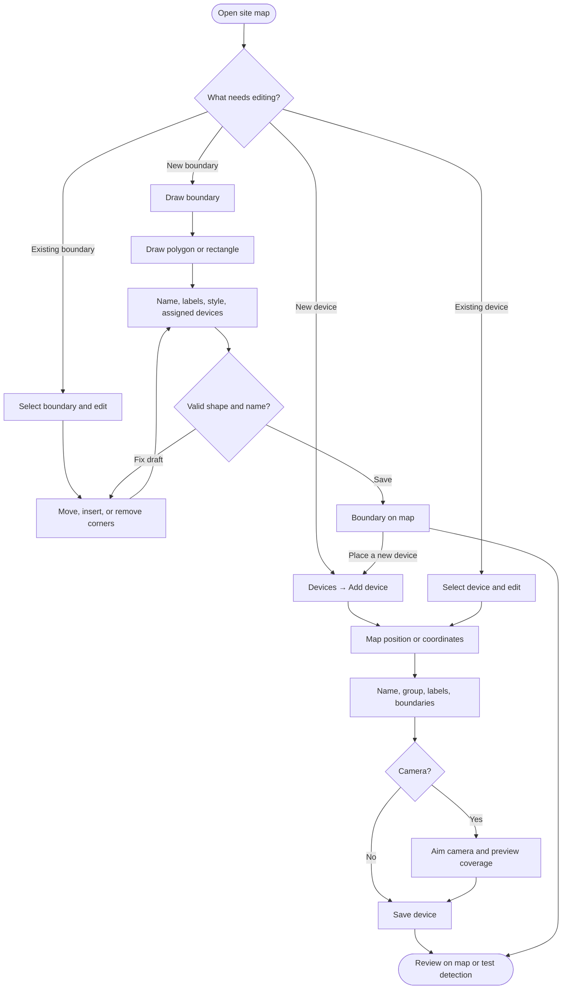

# Global View enterprise monitoring

## Product direction

Global View is the active product. It brings fixed detection appliances into the existing satellite globe so an enterprise operator can draw a site boundary, assign sensors to it, and review alerts in context. Autonomous aircraft development is paused as a cost decision. The flight-research handoffs remain the record of that work.

Use the existing map and imagery stack. The first appliance integrations should translate camera analytics, RF detections, or access-control events into a vendor-independent observation. A customer can then combine different modalities on the same site map without changing the boundary workflow. The UI takes inspiration from area-based monitoring in [Vantor Hub](https://vantor.com/product/platform/hub/) and drawing, layers, and inspection in [Palantir Foundry Map](https://www.palantir.com/docs/foundry/map/getting-started).

## Run the preview

```bash
cd desktop-app
npm ci
npm run dev
```

The app opens Global View at `/` and `/monitoring`. The earlier Proxigo sign-in and flight-research routes remain accessible under `/home` and their existing paths. The default campus and sensor events are synthetic. The preview stores boundaries, devices, groups, labels, and alert reviews in one local browser workspace.

The map fills the workspace. The same left rail provides **Map**, **Site list**, **Cameras**, **Alerts**, **Devices**, **Boundaries**, **Posture**, **Map layers**, and **Search**. Choose **Map**, **Site list**, or **Cameras** to switch workspaces. Selecting a map marker opens its inspector over the map. On narrow displays, panels open at the bottom so the map stays available above them. Use **Search** or Ctrl/Command+K to jump to a device, boundary, or alert with the arrow keys and Enter.

At site zoom, appliances use their device icon and configured map label. Health badges use distinct glyphs and the device label calls out reporting problems and active maintenance. Paused boundaries have dashed edges and a **Paused** label. Camera coverage uses a quieter outline until a camera is selected, and the map legend reflects the visible overlays.

New alerts use a bell and their event name. Alerts at the same coordinates share a marker with a count. Open it to select the other new alerts at that location individually. Acknowledged and resolved alerts remain available in **Alerts** and **Search** and appear on the map when selected. Health and gateway views show alerts related to their current scope. The globe overview omits unselected site markers.

In **Devices**, create or rename groups, then register a device or edit an existing one to place it in a group. Each device has one group or is ungrouped. Add comma-separated labels for categories that span groups, and use a short map label to identify a device on the map. The group and label filters apply to the inventory and device markers together. **Map layers** controls which overlays are visible.

Draw a polygon with **Draw boundary**, add at least three vertices, and assign one or more devices. Select a boundary to rename, redraw, reassign, or pause it. Use **Test detection** or the test action on a boundary or device to exercise the observation-to-alert flow.

Switch between **Satellite** imagery and **Site plan** for a simplified view of roads, buildings, and water. Open **Posture** to locate unassigned boundaries, enabled boundaries without a connected detection adapter, and paused boundaries. Device filters leave these site-wide findings and alert rules intact. Physical coverage requires separate evidence such as verified camera footprints and measured RF coverage.

### Work from Site list

Choose **Site list** on the map rail, or use **Skip to site content**, the first keyboard stop. Site list opens on **Alerts** and also offers **Devices**, **Boundaries**, and **Posture**. Select a row to review the item. On narrow displays, the detail fills the workspace and **Back** returns to the selected row. Search works in both views. Press Escape to close it and return to the control you were using.

Site list supports incident investigation and replay, camera viewing, health triage and maintenance, and device setup using coordinates. Edit a boundary's labels, settings, and assignments from its detail. Use **Map** to draw or change its shape and to see coverage sectors and geographic overlap.

Map is the default for a new browser workspace. The browser remembers your Map or Site list choice separately from your site data. If WebGL fails, Global View opens Site list, announces the failure, and keeps the item you were reviewing. Choose **Map** on the left rail to retry.

Run the keyboard, replay, WebGL fallback, and accessibility checks with Google Chrome installed.

```bash
cd desktop-app
npm run test:e2e
```

## Configuration workflows



**Boundary setup.** Draw a polygon point by point or choose **Rectangle** and pick opposite corners. Edit an existing shape with **Edit vertices**. Drag a corner to move it, click a midpoint to insert a corner, or select a corner and remove it. Enter an internal name, optional map label, labels, notes, and a map color. Posture uses status colors. Assign devices and choose whether monitoring is enabled. Switching to another drawing tool starts a fresh draft shape. Use Undo to restore the previous shape or Cancel to discard the draft.

**Device setup.** Add a device from the inventory or from a saved boundary's inspector to preselect that boundary. Click the map, drag the draft marker, or enter latitude and longitude. Set the name, group, labels, map label, and boundary assignments. Cameras also support **Aim on map**, a numerical bearing, and field-of-view and HLS settings. For an access-control device, set **Linked camera** to make that camera available from the device and its new alerts. Saving a device and its boundary assignments is one update. Device placement and boundary assignment are independent so a device can monitor an adjacent area.

**Change a device type.** Use **Edit device → Device type** to reclassify a registered appliance. Saving retains its ID, location, assignments, and reporting health. Changing a camera to another type clears its feed, modeled field of view, and access-device links. Changing an access device to another type clears its linked-camera setting. Recorded clips and alert history stay with their incidents.

### Customization research

- **Boundary editing.** ArcGIS Map Viewer exposes editable vertices and snapping. Global View uses direct corner editing and midpoint insertion within the existing map. Save validates simple polygons and blocks self-crossing drafts. [ArcGIS Map Viewer editing](https://doc.esri.com/en/arcgis-online/latest/manage-data/edit-features-mv.html)
- **Drawing tools.** MapLibre's Terra Draw example exposes several primitives and a selection mode. Polygon and rectangle match irregular perimeters and rectangular yards in this workspace. Snapping and GIS imports are additional options for surveyed sites. [MapLibre drawing example](https://maplibre.org/maplibre-gl-js/docs/examples/draw-geometries-with-terra-draw/)
- **Device placement.** Verkada's site floorplan editor uses map-based device placement, labels, and camera direction. Global View applies those interaction patterns to outdoor sites with geographic coordinates, independent device-to-boundary assignments, and a preview of the configured camera sector. [Verkada floorplan editor](https://help.verkada.com/command/organization-settings/buildings-and-floors/create-a-floorplan)

### View a camera feed

Select the camera on the map or in **Devices** to open its feed in the inspector. Demo cameras without an assigned stream show a labeled simulation. To connect a real stream, open **Edit device**, enter its **HLS feed URL**, and save. Use a browser-accessible playback URL supplied by the camera gateway or video management system. For an RTSP camera, have the gateway publish its stream as HLS. Keep camera credentials and long-lived tokens at the gateway.

Use HTTPS for a deployed workspace. For a gateway on another origin, allow the Global View origin to read the manifest and media segments through CORS. The selected feed starts muted and closes when you select another device or close the camera inspector. Video playback and detection adapter health are separate. [HLS.js playback and CORS documentation](https://github.com/video-dev/hls.js#cors)

### Monitor multiple cameras

Open **Cameras** from the left rail. **Camera view** switches between **Live wall**, **Camera directory**, and **Coverage** within the workspace. Choose **Map** or **Site list** on the same rail to leave Cameras. The live wall displays 1, 2, 4, or 9 cameras per page. Open **Filters & layout** to search by name, label, or channel and filter by group or assigned boundary. Pin cameras for a watchlist. **Save wall as** saves the matching camera set and layout to this browser. **Pause wall** disconnects its players while keeping the cameras and their reporting status visible. Switching pages or leaving Cameras releases the wall players.

Open a tile's **Focus** control or choose **View** in the **Camera directory** to see one camera and its configured field of view, assigned boundaries, linked doors, recent recordings, and incidents. The directory can filter for cameras that need a feed, need a field of view, or have reporting issues. Select a recording to seek to its event time, or open an incident to continue the investigation.

**Add camera** and **Edit camera** open the existing device setup. Enter the primary HLS URL and, optionally, a lower-bandwidth HLS URL. Enter the video system and channel reference to help operators find the source recorder. Test each URL in **Appliance setup** before saving. The wall prefers the lower-bandwidth feed when configured. Focused viewing defaults to the primary feed and lets operators choose either stream when both are available.

The workspace uses a dark, video-first grid with compact tile controls and separate device health and playback labels. Saved wall layouts follow the multi-feed workflows documented by Verkada, the focused view follows Milestone's camera-to-grid navigation, and the recording labels follow Genetec's distinction between live and recorded video. [Verkada camera grids](https://help.verkada.com/verkada-cameras/video-streaming-and-sharing/live-streaming/grids) · [Milestone live video](https://doc.milestonesys.com/xprotect/xprotect-web-client/2026r1/en/viewing-live-video) · [Genetec live and playback modes](https://techdocs.genetec.com/r/en-US/Security-Desk-Getting-Started-Guide-5.14/Live-and-playback-video-modes)

### Configure camera visibility

Select a camera icon and choose **Edit device** to configure its field of view. Enter the camera's bearing clockwise from true north, the full horizontal viewing angle, and the estimated useful detection range in meters. For example, 0° points north and 90° points east. The map previews changes while you edit. Other devices use their own icons and remain visible alongside cameras.

Sage shows each configured camera sector. Muted violet shows where at least two sectors overlap. Open **Posture** to see rose areas inside enabled boundaries that fall outside all configured camera sectors, along with an approximate gap percentage per boundary. **Map layers** controls whether the camera geometry is drawn. The analysis considers all configured cameras at the site, including cameras hidden by device filters. Cameras without configured geometry contribute no modeled area.

The overlay models horizontal coverage on a flat site. It assumes the configured bearing, width, and range are accurate and excludes building or terrain occlusion, camera tilt, and live feed health. The demo uses example camera geometry.

In **Cameras → Coverage**, boundaries with the largest modeled gaps appear first. Each row shows the estimated covered and uncovered percentages and can open the relevant area on the map with the coverage overlays enabled.

## Test and monitor appliances

Start **Add device** or **Edit device** and open the **Appliance setup** section. After placing the appliance and assigning an enabled boundary, choose **Test alert route**. The preview runs a simulated detection through the draft assignments and leaves the operator's alert queue and health history untouched. For a camera, enter an HLS URL and choose **Test camera feed** to verify browser playback before saving.

Use the draft's **Device ID** to match the appliance or site adapter's ID. Set **Health source URL** to the gateway endpoint for that device and choose **Test health source** to verify that it responds with a matching report. You can also use **Import test report** to validate a JSON file from the appliance. The newest report is committed with **Save device**. For a registered appliance, the main toolbar's **Import JSON** can update health without opening the editor. Set the expected interval to the appliance's reporting cadence. The default is 60 seconds.

```json
{
  "type": "health",
  "sensorId": "gate-01",
  "occurredAt": "2026-11-22T18:40:00Z",
  "state": "online"
}
```

Use `online` for a heartbeat and `offline` for a reported disconnect. The map and inventory show **Online** for a recent online report, **Offline** after an explicit offline report, **Stopped reporting** after three expected intervals without a fresh online report, and **No reports** until the first report. A newer online report restores the online state. Older reports leave the latest state intact. The inspector shows the last report time. Find the marker legend in **Map layers → Device health** and the site counts in **Posture**. Seeded statuses are labeled as simulated.

The health endpoint responds to an HTTP GET with one JSON report in the same format. Allow the Global View origin in CORS and use HTTPS in a deployed workspace. The browser uses a read-only request without cookies or login credentials. Keep upstream appliance credentials at the gateway. Global View polls configured endpoints and evaluates report age while the page is open. A failed request leaves the last report to age. Return the appliance's actual heartbeat timestamp on every request so a reachable gateway cannot mask a stalled device. Camera playback, simulated detections, and imported observations leave reporting health unchanged. Monitoring with the workspace closed and sharing health across operators require the enterprise service.

### Triage device health in Posture

**Site insights** groups current risk, verification checks, and open incidents by boundary. Select a count to filter the list, expand a boundary for its evidence, then open the camera, boundary, or incident. Return to Posture to keep your filter and selection. A recording check reflects the latest recorded commissioning drill for that camera and boundary in the current published version. The rule mode shows whether the rule observes or creates alerts. If a shared site disconnects, Posture identifies the last available data.

Choose a health count in **Posture** to show matching devices on the map and highlight their assigned boundaries in orange, including paused boundaries. Select a device or boundary from the list to center it. **Clear health filter** restores the normal map view and camera coverage overlays.

Open **Outage history** to see ongoing and recovered outages. Selecting a device in the filtered results narrows history to that device. A reporting gap starts after three missed intervals and recovery is recorded when a newer online report arrives. The list shows the latest 50 outages for the current view. Simulated demo statuses have no recorded history.

Open **Maintenance → Schedule maintenance**, choose a device, and enter start and end times and a reason. Times are entered in the browser's local timezone. The map adds a clock badge during the scheduled period and keeps the device's measured health and security alerts visible. You can cancel a future window or end an active one early. The history marks outages that began during maintenance. Schedules and outage history are stored in this browser workspace.

### Review a gateway outage

Enter the same **Gateway ID** under **Appliance setup** on devices served by that gateway. Use a distinct ID for each gateway. IDs are case-insensitive and support letters, numbers, periods, hyphens, and underscores.

**Alerts → Gateway outages** shows one incident when at least two devices assigned to the same gateway have overlapping recorded outages that start within two minutes of one another. A device can report Offline or pass its heartbeat deadline. The incident records correlated reporting loss as its evidence. Simulated and unreported devices stay outside the correlation. The incident can pick up more affected devices while it is open.

Open the incident to see its devices and the boundaries assigned to them when they joined the outage. The map highlights affected boundaries in orange and changes them to sage when all of their incident devices recover. Select a row to center a device or boundary, or choose **Fit outage on map** to see the whole area. The incident recovers after all listed devices report online. **New** shows active outages, and **All activity** includes the last 50 recovered ones. Security alerts and individual device outage histories continue alongside gateway incidents. The preview stores gateway incidents in the local browser workspace.

## Import an appliance observation

An adapter or test harness can export normalized events as JSON. **Import JSON** accepts a single observation, a health report, or a telemetry batch in the form `{"type":"telemetry","observations":[...]}`. Each batch entry follows the observation format below. The following example uses a seeded sensor ID and a point inside the demo restricted yard.

```json
{
  "id": "yard-rf-001",
  "sensorId": "rf-01",
  "occurredAt": "2026-11-22T18:40:00Z",
  "position": [-122.3014, 37.7884],
  "summary": "RF energy detected"
}
```

Use the registered sensor ID shown in its inspector. An event with a reported position uses WGS84 longitude/latitude order and creates one alert for each enabled boundary that contains the position and has that sensor assigned. A fixed access-control device can omit `position`. Global View then uses the registered device location for the pin and the device's enabled boundary assignments for routing. Vision and RF events with no reported positions remain available in replay with **Location unavailable**. The preview rejects unknown sensors and deduplicates event IDs per sensor. Restricted zones produce high-priority alerts. The preview treats the polygon edge as part of the boundary and accepts simple local polygons that stay on one side of the date line.

An event can include a `recording` from its source camera or linked camera. The optional `eventOffsetSeconds` determines where playback starts and defaults to zero. Supply `durationSeconds` when the adapter knows the clip's duration. Replay uses it with the event's UTC timestamp and offset to match nearby events to a clip from the same camera or an assigned boundary. Supply a browser-accessible MP4 or finite HLS recording URL from a camera gateway or VMS. Keep credentials at the gateway and follow the playback requirements above.

```json
{
  "id": "east-gate-001",
  "sensorId": "gate-01",
  "occurredAt": "2026-11-22T18:40:00Z",
  "summary": "Unscheduled gate opening",
  "recording": {
    "cameraId": "cam-02",
    "format": "mp4",
    "url": "https://video.example.com/clips/east-gate-001.mp4",
    "eventOffsetSeconds": 5,
    "durationSeconds": 18
  }
}
```

## Investigate an alert

Open an alert from the map, **Alerts**, or **Search**. An alert at its source device appears as a bell badge beside the device icon. The inspector shows the triggering boundary, device, time, and event location and highlights the boundary on the map. Choose **Event recording** when a clip is supplied, or **Live camera** for the associated camera's configured feed. New alerts keep their camera association when device settings change.

Use **Acknowledge alert** to mark it as under investigation, or **Take ownership** to enter an operator name and start investigating. An assigned operator can add notes and resolve the alert with a disposition. The activity list retains ownership changes, notes, and the resolution in the browser workspace. Names are entered locally. Shared review and authenticated operator identity require the enterprise service.

### Replay an incident

Open an alert and choose **Replay timeline**. The timeline lists site observations up to 15 minutes before and after the alert, oldest first in UTC. A detection that triggered alerts in multiple boundaries has one timeline row. The browser retains the latest 500 accepted observations alongside the existing alert history. New observations within the time window appear without closing the replay.

Select a row or use **Previous event** and **Next event**. Located events center a labeled replay marker on the map. In Site list, the selected event shows its boundary and reported coordinates. Events with footage seek to their timestamp in the clip. The panel shows when a location or recording is unavailable. **Back to incident** returns to the original alert and its investigation.

The preview uses imported and simulated observations. For the enterprise pilot, site adapters should normalize door, camera, and RF telemetry at the gateway. A shared service can then ingest and persist those observations continuously and supply one chronological replay across operators.

## Next operator and integration improvements

1. **Share health triage across operators.** Posture already filters devices, highlights their assigned boundaries, and records outages and maintenance in the local workspace. Move that state to the shared service and use maintenance windows to pause health notifications while measured status and security alerts stay visible. [Genetec health and status workflows](https://techdocs.genetec.com/r/en-US/Finding-the-right-task-to-use-in-Security-Desk/Finding-the-right-task-to-use-in-Security-Desk) · [Genetec maintenance mode](https://techdocs.genetec.com/r/en-US/Security-Center-Administrator-Guide-5.12/Setting-entities-to-maintenance-mode-in-Security-Center)
2. **Deliver gateway outage notifications.** The preview groups correlated device failures and tracks recovery in Alerts. Move that logic into the shared service so it can send one outage notification and one recovery update even when the workspace is closed. [Prometheus Alertmanager grouping and inhibition](https://prometheus.io/docs/alerting/latest/alertmanager/) · [Verkada camera status alerts](https://help.verkada.com/verkada-cameras/analytics/create-camera-event-alerts/camera-status-alerts)
3. **Validate recorder clocks at the site.** Replay aligns two eligible recordings by their event timestamps. Measure end-to-end skew on the installed camera and recorder pair before relying on sub-second comparisons. [Milestone XProtect timeline](https://doc.milestonesys.com/xprotect/xprotect-smart-client/2026r2/en/the-main-timeline)
4. **Speed up site setup.** Add a CSV device roster with a map preview and row-level validation before applying changes. Match existing devices by stable IDs so reimport updates the device in place. Test the import with duplicate IDs, missing coordinates, and rows that change an assignment. [Verkada bulk device setup](https://help.verkada.com/command/organization-settings/add-a-device-to-your-command-organization)
5. **Pilot a read-only door controller and camera analytics adapter.** Start with door-forced-open and held-open events from the customer’s installed access controller. Pair them with a linked camera recording. For camera analytics, assess ONVIF Profile M support against the specific model and firmware. Keep video playback on its separate path. Pilot one device of each type before adding vendors. [Axis door event documentation](https://developer.axis.com/vapix/physical-access-control/door-control-service/) · [ONVIF Profile M](https://www.onvif.org/profiles/profile-m/) · [ONVIF conformance](https://www.onvif.org/profiles/conformance/)

Carry shared health state, outage notifications, and read-only adapters into the gateway pilot. Track whether operators can find the affected boundary and distinguish a planned outage from an unexpected one without leaving the map.

## Camera operations pilot

- **Video health in Posture.** The gateway samples active HLS output and decodes one frame periodically from each idle camera. Posture separates video availability from the appliance heartbeat and shows the last observed video. Coverage impact excludes unavailable cameras from the existing model and labels remaining coverage as an estimate. `--probe-interval` controls the minimum spacing between idle checks per camera. External HLS-only sources continue to report playback state in the wall.
- **Coverage commissioning.** Set **Shape blocks camera coverage** when a boundary represents an obstruction. The model stops each horizontal line of sight at the first marked obstruction. Boundaries may be paused for detection and still block camera coverage. In a focused camera, **Mark view checked on site** records an operator field check. Changes to camera placement, modeled view, or primary feed clear the field check.
- **Investigations.** **Open incident cameras** lists the linked camera first, then cameras whose modeled view contains the event position. **Compare camera angles** is available when two recordings have a known duration and both cover the selected event. Operators can play, pause, or seek both views from one timeline. The incident owner can record a response checklist, next action, and handoff note. These stay in the browser workspace.
- **Recorder clips.** Start the gateway with `--axis-recorder https://CAMERA_IP` on a supported Axis edge recorder with storage enabled and `ffprobe` installed. The configured origin must match the registered RTSP source host. Global View requests a short clip around the linked incident with the gateway's stored camera credentials, then shows retrieval, availability, or missing footage. Imported clips remain usable in the same replay timeline. [Axis edge storage API](https://developer.axis.com/vapix/network-video/edge-storage-api/)
- **Evidence.** Bookmark a time range and export the incident evidence index as JSON. A gateway administrator can hold the retrieved recorder clip for seven days. The receipt includes the operator name, expiry, and SHA-256 of the preserved MP4. Holds apply to the cached copy of the retrieved clip. Recorder retention policies stay on the recorder.
- **Camera events.** In the camera detail, use **Gateway access and analytics → Get camera event token**. Configure a supported camera or site adapter to POST JSON containing `id`, `occurredAt` as an ISO timestamp with timezone, and `event` as `motion`, `line-crossing`, or `tamper`. Send the camera event token in the Bearer authorization header. The gateway deduplicates and stores events. Global View polls them and uses the camera's enabled boundary assignments. The displayed position identifies the camera. Installers configure vendor webhooks or translators separately. [Axis event services](https://developer.axis.com/vapix/network-video/event-and-action-services/)
- **Shared camera viewing and notifications.** Use **Create camera viewer link** to grant temporary live access to one camera. A viewer needs network access to the gateway and the Global View hostname. Optional `--video-webhook https://receiver.example/path` delivers grouped video outage and recovery events while the workspace is closed. Set `PROXIGO_WEBHOOK_SECRET` on the gateway and verify the hex HMAC-SHA256 of the raw JSON body using `X-Proxigo-Signature`. The receiver can deduplicate retries by `deliveryId`. Viewer links and gateway notifications are site-local pilot features. Enterprise operator identities, shared incident state, and centralized policy still require the shared service.

## First enterprise pilot

Begin with one customer site, two operator accounts, one camera analytics feed, and one additional appliance adapter. Publish the site's draft to turn on gateway rule evaluation. Measure missed events, false alerts, and delivery latency against agreed site scenarios before expanding the pilot.

## Incident queue and indoor map

- **Alerts** lists incidents by priority and age. Open **History filters and saved searches** to filter by status, boundary, device, event type, UTC date, and attached recording. **Open event clip** selects the exact event in replay. Saved searches live in the browser. Recorder footage is discovered when the incident is opened.
- **Door and camera correlation** previews retained history before an operator enables a rule. One forced-door event pairs with one line crossing from the door’s linked camera on the same boundary within the configured window. The first received alert becomes the incident. Both observations remain in replay. Imported telemetry can set `eventType` to `door-forced-open`, `door-held-open`, `line-crossing`, `motion`, `tamper`, or `rf-detection`.
- **Handoffs** lists pending transfers and marks them overdue. An owner can include a UTC due time in **Response checklist and handoff**. A receiving operator can accept the transfer. On a shared site with `--video-webhook`, an overdue high-priority handoff yields one `incident-handoff-overdue` delivery for that handoff.
- **Map layers → Buildings and floor plans** accepts a north-up PNG or JPEG served over HTTPS, with browser access and CORS allowed. Enter northwest and southeast coordinates as longitude, latitude. Assign a site level in the device and boundary editors. A floor selection scopes map devices, alerts, and coverage, and **Site list** offers the same level in Devices and Boundaries. Indoor incident replay switches to the event’s recorded level.
- **Video quality inspection** reports suspected frozen, dark, obstructed, or defocused images based on small gateway samples. Static and low-light scenes can trigger flags. An operator can confirm an issue or clear it after rechecking. Posture recalculates modeled coverage after excluding cameras with confirmed issues or unavailable video.
- **Live wall profile** can use a second ONVIF profile. Direct RTSP setup accepts a separate secondary RTSP URL on the same host. The gateway verifies both streams and publishes a reduced-size wall stream. The wall uses it when present and the focused view starts with the primary feed.

A local nine-tile Chrome check used synthetic H.264 inputs at 1280×720 and 640×360. Over roughly 10 seconds of wall playback, the secondary profiles reduced delivered video from 10.8 to 3.2 Mb/s and aggregate FFmpeg CPU from 98% to 29% of one logical core. The last tile began playing after 6.4 seconds with primary profiles and 7.6 seconds with secondary profiles. These are local fixture measurements.

## Signed evidence and Profile G pilot

After preserving a recorder clip, open **Evidence bookmarks and retention → Signed evidence package**. Select up to four gateway clips with active holds. A management token or authorized supervisor token can export the package. Add an optional black rectangle using percentages of the image width and height. Review the exported video to confirm the mask covers the intended area. The original held clip stays available under its hold. The package includes the incident events, hold receipts, exported file checksums, a detached signature, and the gateway’s public signing key. The gateway records the export in its audit database.

Obtain the trusted public key directly from the site administrator. Keep that copy outside the archive and use it to verify the package.

```bash
openssl pkey -in /path/to/gateway-state/evidence-signing.pem -pubout -out trusted-site-key.pem
python3 services/camera-gateway/verify_evidence.py proxigo-incident-evidence.zip trusted-site-key.pem
```

Profile G is an opt-in H.264 pilot. After registering the camera by ONVIF, pass `--onvif-recordings /path/to/recordings.json` with a JSON mapping from the Global View device ID to the recorder’s assigned recording token. Reconnect registrations made before ONVIF device addresses were stored. Install GStreamer 1.18 or later with RTSP, RTP H.264 depayloader, H.264 parser, Matroska plugins, and PyGObject. Use `--onvif-capture-python` if those bindings use a separate Python executable. The adapter requires the ONVIF RTP replay clock extension and rejects footage it cannot align to the event. Validate the camera model, firmware, codec, and recording clock before a site rollout. [ONVIF Profile G](https://www.onvif.org/profiles/profile-g/) · [GStreamer RTSP source](https://gstreamer.freedesktop.org/documentation/rtsp/rtspsrc.html)

## Shared site operation and durable telemetry

Start one gateway per site. A private `--telemetry-devices` JSON file maps registered adapter device IDs to independently generated 64-character hexadecimal tokens. A door controller integration posts a normalized event to `/api/site/telemetry` using its device token as a Bearer credential. A health report uses the same endpoint with `type` set to `health` and `state` set to `online` or `offline`. Each entry needs a stable source `id`, `sensorId`, and UTC or offset-qualified `occurredAt`. The gateway attaches its receipt timestamp and deduplicates retried IDs within retained history.

```json
{
  "type": "observation",
  "sensorId": "gate-01",
  "id": "door-controller-72541",
  "occurredAt": "2026-11-22T18:40:00Z",
  "eventType": "door-forced-open",
  "summary": "Loading dock gate forced open"
}
```

The gateway retains up to 10,000 recent events in SQLite while Global View is closed. Optional `--telemetry-upstream https://receiver.example/api/site/telemetry` forwards through a durable outbox. Set `PROXIGO_TELEMETRY_UPSTREAM_TOKEN` on the source and the same `PROXIGO_TELEMETRY_RECEIVER_TOKEN` at the destination. A full outbox returns a retryable error to the sender. Posture shows connection status and backlog age when connected with site-wide read access. Use **Site telemetry connection** in Posture with `PROXIGO_TELEMETRY_READER_TOKEN`, or use a signed-in operator session with its assigned device scope.

Enable shared incident ownership, notes, checklists, handoffs, and maintenance with `--site-access /path/to/site-access.json`. Published site inventory and incident actions are shared. Saved searches and preview-only configurations live in each browser. Before the first publication, the legacy telemetry reader can use `deviceCameras` to identify cameras linked to access controllers. The published device inventory supplies those relationships once a version is active.

```json
{
  "site": "Loading dock pilot",
  "siteId": "loading-dock",
  "timeZone": "America/Los_Angeles",
  "organization": { "id": "harbor-logistics", "name": "Harbor Logistics", "directoryTenant": "your-directory-tenant-id" },
  "deviceCameras": { "gate-01": "cam-02" },
  "operators": {
    "directory-subject-for-admin": { "name": "Organization admin", "role": "org-admin", "cameras": "*" },
    "directory-subject-for-operator": { "name": "Shift operator", "role": "operator", "cameras": ["cam-02"] },
    "directory-subject-for-supervisor": { "name": "Site supervisor", "role": "supervisor", "cameras": "*" }
  }
}
```

For local setup, generate an independent 64-character hexadecimal token for the bootstrap admin with `openssl rand -hex 32`. Add its SHA-256 as `tokenSha256` in the admin's operator entry. Keep the plaintext token private. The access file seeds accounts on first initialization. Later changes live in the site database and use **Posture → Organization accounts**. A site supervisor can manage configuration and maintenance. An organization admin can also provision members, set camera scope, disable accounts, and issue or rotate site tokens. Changing scope, disabling an account, or revoking its token invalidates gateway viewing links issued by that account.

## Enterprise sign-in

Deploy the enterprise portal as the public HTTPS entry point. Operators enter their organization ID, sign in with their work account, and choose among the sites where they have an active membership. The portal uses OpenID Connect Authorization Code with S256 PKCE, a browser-bound one-time state, and a verified RS256 ID token. It validates issuer, audience, nonce, and time claims. Configure `tenantClaim` when the directory provides a tenant claim. The portal creates an eight-hour server-side session with an HttpOnly, Secure cookie and revokes it on sign-out. Each new sign-in asks the provider to reauthenticate. [OpenID Connect Core](https://openid.net/specs/openid-connect-core-1_0.html) · [OAuth 2.0 Security BCP](https://www.rfc-editor.org/rfc/rfc9700.html)

Each customer uses its own organization ID and sign-in configuration. Connect the customer's work identity provider for single sign-on, or configure an OpenID Connect provider that signs users in with their customer email addresses. Global View uses the verified directory subject for enrollment and checks the customer's site membership and camera scope separately from sign-in.

For customer-facing deployments, use the [production sign-in configuration](../infra/auth0-global-view/README.md) for hosted email and password, Google, Microsoft, and customer SSO. Production mode verifies authenticator completion before issuing a portal session.

1. Register a confidential web client for each organization with its own exact issuer and callback. For Microsoft Entra, use the tenant-specific v2 issuer, `tid` as the tenant claim, and `client_secret_post` for token exchange. Register the redirect URI as Web. Use the verified `sub` claim as the stable subject in **Organization accounts** at each authorized site. Role and camera scope come from that site's account record. [Microsoft Entra OpenID Connect](https://learn.microsoft.com/en-us/entra/identity-platform/v2-protocols-oidc)
2. Start each gateway with `--site-access`, `--require-camera-session`, and a distinct `PROXIGO_IDENTITY_PROXY_TOKEN` created with `openssl rand -hex 32`. Match `organization.id`, `organization.directoryTenant`, and `siteId` to the portal configuration. Keep gateway listeners private. Use HTTPS for portal-to-gateway links across hosts. A loopback HTTP gateway can run on the portal host.
3. Create the private portal JSON file. This example registers the callback `https://security.example/api/enterprise/callback/harbor-logistics`. Keep the client secret and site proxy tokens in the server-side config file with restricted permissions.

```json
{
  "publicOrigin": "https://security.example",
  "organizations": {
    "harbor-logistics": {
      "issuer": "https://login.microsoftonline.com/DIRECTORY_TENANT_ID/v2.0",
      "clientId": "APPLICATION_CLIENT_ID",
      "clientSecret": "APPLICATION_CLIENT_SECRET",
      "directoryTenant": "DIRECTORY_TENANT_ID",
      "tenantClaim": "tid",
      "tokenEndpointAuthMethod": "client_secret_post",
      "sites": {
        "loading-dock": {
          "origin": "https://loading-dock.internal.example",
          "proxyToken": "THE_64_HEX_CHARACTER_GATEWAY_PROXY_TOKEN"
        }
      }
    }
  }
}
```

The default token endpoint method is `client_secret_basic`. Give each issuer, gateway URL, and gateway proxy token its own configuration entry. Publish the site inventory and provision RTSP/ONVIF feeds on the gateway before handing the portal to operators. Enterprise playback routes live streams and recorder clips through the authenticated site gateway. The browser receives an organization-bound route and the gateway verifies active membership and camera scope for each media or incident request. Camera wall presets in enterprise mode stay in the open site workspace on shared computers.

Build and start the portal from the repository root. Route `publicOrigin` to the portal listener with an HTTPS terminator. Preserve the browser `Origin` header and omit callback query strings from proxy access logs. The configured portal serves the built frontend and relays authenticated site routes on that same origin.

```bash
npm --prefix desktop-app ci
npm --prefix desktop-app run build
python3 -m venv ~/.local/share/proxigo/enterprise-venv
~/.local/share/proxigo/enterprise-venv/bin/python -m pip install -r services/camera-gateway/enterprise-requirements.txt
~/.local/share/proxigo/enterprise-venv/bin/python services/camera-gateway/enterprise_portal.py \
  --config /private/proxigo/portal.json \
  --frontend desktop-app/dist \
  --state /private/proxigo/portal.sqlite3
```

The Chrome fixture uses two local OIDC issuers and four gateways with an overlapping operator subject and site/camera IDs. It covers membership and camera scope, signed login, rejected identity claims, live HLS with MediaMTX, cross-organization routes, and session revocation. To run it after building, set `PROXIGO_ENTERPRISE_PYTHON` to the absolute path of the virtual environment's Python and `MEDIAMTX` to the MediaMTX binary, then run `npm --prefix desktop-app run test:e2e -- enterprise-sign-in.spec.ts`. Customer IdP and HTTPS routing still need validation in the target environment.

### Internal Proxigo Microsoft 365 work accounts

The `proxigo` tenant configuration below serves Proxigo employees and internal testing.

Register **Proxigo Global View Pilot** as a single-tenant **Web** app in the Proxigo Entra tenant. Register the portal's exact HTTPS callback ending in `/api/enterprise/callback/proxigo`. The local pilot uses `https://localhost:8775/api/enterprise/callback/proxigo` with a localhost HTTPS terminator. Register the deployed HTTPS origin separately when that environment is ready. Use only the `openid` and `profile` delegated scopes for the object-ID enrollment below. [Microsoft Web app registration](https://learn.microsoft.com/en-us/entra/identity-platform/how-to-add-redirect-uri)

Upload the portal's public RSA certificate under **Certificates & secrets → Certificates**. Store the matching PEM private key in the portal's private deployment configuration with owner-only permissions. Use absolute file paths and omit `clientSecret` for this certificate-based registration. [Microsoft certificate credentials](https://learn.microsoft.com/en-us/entra/identity-platform/certificate-credentials)

```json
{
  "publicOrigin": "https://localhost:8775",
  "organizations": {
    "proxigo": {
      "issuer": "https://login.microsoftonline.com/PROXIGO_ENTRA_TENANT_ID/v2.0",
      "directoryTenant": "PROXIGO_ENTRA_TENANT_ID",
      "tenantClaim": "tid",
      "subjectClaim": "oid",
      "clientId": "ENTRA_APPLICATION_CLIENT_ID",
      "tokenEndpointAuthMethod": "private_key_jwt",
      "clientCertificate": "/private/proxigo/entra-client.cer",
      "clientPrivateKey": "/private/proxigo/entra-client.key",
      "sites": {
        "pilot": {
          "origin": "http://127.0.0.1:8777",
          "proxyToken": "THE_64_HEX_CHARACTER_GATEWAY_PROXY_TOKEN"
        }
      }
    }
  }
}
```

For the new site, use `proxigo` as the organization ID, `pilot` as the site ID, and the same `directoryTenant` in the gateway's private site access file. Use each approved founder's lowercase **user Object ID** from the Proxigo directory as their account subject. Assign their Global View role and camera scope in the site roster. Explicit membership applies even to Entra Global Administrators. Existing organizations default to `sub` and can retain their current enrollment and token exchange. [Microsoft ID token claims](https://learn.microsoft.com/en-us/entra/identity-platform/id-token-claims-reference)

Verify in the portal with organization ID `proxigo`. Complete the Microsoft sign-in and MFA, open the authorized site, and check that an account without a site membership sees an empty site list. Confirm that sign-out invalidates the Global View session. Public tenant discovery and signing keys can establish reachability before registration. A completed callback and authorized site session establish sign-in.

Exchange Online receives ordinary business mail through the public MX. Global View delivers incident notifications through its signed webhook and has no inbound mailbox processing. This sign-in integration uses only identity scopes and leaves email delivery with Exchange and AWS account recovery with the separately controlled recovery mailboxes.

## Publish site configuration and run always-on alerts

1. Connect in **Posture → Shared site operator access** with a supervisor or organization admin account.
2. Open **Site configuration and versions**. Start with the preview inventory, a saved draft, or the current published version. Edit boundaries, assignments, floors, and infrastructure in the existing workspace. Configure door and camera correlation in **Alerts** while the draft is open. Register new ONVIF or RTSP sources through camera setup before incorporating their playback URLs into a draft.
3. Use **Draft mode · Review changes** to save the shared draft and inspect field changes. **Run a configuration drill** accepts timestamped observation JSON and calculates results without accepting those events into the live stream.
4. Enter a version note and publish. All connected workstations receive the published inventory. Restoring a prior configuration creates a new version. Conflicting updates require a refresh before retrying.

The gateway writes accepted telemetry, incidents, and initial notification records together. It chooses the configuration that was active when the device event occurred. The first qualifying door or linked-camera event creates the incident. The second can attach within the configured occurrence-time window and late-arrival allowance. Alerts display their configuration version and replay retains both source events. Events older than the allowance remain available for review. Telemetry received before the first published configuration remains in the telemetry log.

Use `--alert-webhook https://receiver.example/security` and set `PROXIGO_WEBHOOK_SECRET` to deliver signed security notifications. The delivery outbox survives gateway restart. Retries retain the same `deliveryId`, so receivers can deduplicate after a lost acknowledgement. Configure a separate `--commissioning-webhook https://receiver.example/drill` for labeled test notifications if needed.

In Chrome the pilot closes both operator sessions, submits a forced-door event, rejects the first webhook delivery, restarts the gateway, and submits the delayed camera event. After reopening Chrome, both accounts open the same incident and see both original events. This test uses simulated device telemetry and a local TLS receiver.

## Site readiness, dispatch, and recorder continuity

- **Infrastructure and site readiness** lets a supervisor add gateways, PoE switches, and UPS units in a draft and assign them in each device editor. Adapter health reports use the dependency's registered ID and token. Posture shows reported outages and suspected common dependencies, lists associated boundaries, and accepts one maintenance ticket URL per outage. **Plan a coverage outage** models removing a camera or all cameras assigned to a dependency. It identifies boundaries whose last verified view would be lost when field checks or commissioning results are available.
- **Commissioning and replacement** records door, incident, clip, and notification checks against the current published version. A supervisor can use the configured test destination, review the receipt, and save follow-up items. Results retain their original version when the site is republished.
- **Organization dispatch** accepts other authenticated gateways with the same organization ID. Alerts and Posture show facility time, freshness, open incidents, and the response team configured on each boundary. Select an incident to switch to that site and floor. Site credentials stay in the current browser session. Each gateway continues local evaluation through WAN interruptions.
- **Recording recovery** is opt-in with `--recording-recovery` and an Axis or Profile G recorder. The gateway queues incident windows, waits for video recovery when an outage is reported, and prioritizes high-priority incidents. Replay labels verification, pending retrieval, and gaps. One recovery runs at a time. `--recovery-kbps` paces Axis clip transfers. Profile G uses its recorder's RTSP delivery rate. **Recorder footage verified** records a successful check at the indicated time.
- **Read-only XProtect integration** uses `--milestone-origin https://xprotect.example`, `--milestone-token-file /path/to/token`, and optionally `--milestone-event-map /path/to/map.json`. Use a user token with rights restricted to the site's cameras. The gateway reads the token file on each request. **XProtect camera catalog** in the site draft imports a camera with a stable `xprotect-GUID` ID and the entered map coordinates. Map vendor event type GUIDs under `eventTypes` and vendor resource strings under `sources` in the event map. The connector reads stored events and sends matched events through the site's durable telemetry path. For a published XProtect-linked incident, **Play from XProtect recorder** starts WebRTC at the incident time. The browser needs network access for media, and the gateway handles scoped signaling with the vendor token. Validate playback and event mappings with the installed XProtect version. [XProtect integration APIs](https://doc.developer.milestonesys.com/mipvmsapi/api-overview/) · [XProtect WebRTC playback](https://doc.developer.milestonesys.com/mipsdk/gettingstarted/intro_WebRTC.html)

## Add computer vision to installed CCTV

See [CCTV analytics for Global View](cctv-analytics.md) for versioned people, vehicle and possible drone rules, cloud and on-premises compute placement, local replay, and pilot evidence.

See the [industry vision pilot](industry-vision-pilot.md) for dock occupancy, factory observations, held-open door corroboration, simulated inspection, and the local regression gates.

See [commissioning and industry operations](global-view-vnext.md) for tripwire comparison, shared dock schedules, door passage review, native camera events, and OPC UA inspection.

See [enterprise operations](global-view-enterprise-operations.md) for guided procedures, evidence search and cases, bulk inventory import, VMS connectors, dispatch, and encrypted site recovery.

## Connect an ONVIF or RTSP camera

Run the site gateway on a computer that can reach the camera network. It needs Python 3.10 or later and FFmpeg with `libx264`. From the repository root, replace the example CIDR with the approved camera subnet or a single camera IP with a `/32` prefix.

```bash
python3 services/camera-gateway/gateway.py --allow-source 192.168.1.0/24
```

1. In **Cameras → Add camera**, set the name and coordinates. Under **Camera connection**, choose **ONVIF camera** or **RTSP camera**.
2. Use `http://127.0.0.1:8765` for a gateway on this computer. Paste its management token from `~/.local/share/proxigo-camera-gateway/management-token`. Use the printed token path if the gateway was started with `--state-dir`.
3. Enter the full ONVIF device address (typically `http://CAMERA_IP/onvif/device_service`) or the RTSP URL from the camera or recorder. Enter its read-only username and password in the separate fields. **Find ONVIF profiles** lists available streams. Choose a profile or use the first. The gateway supports addressed Media2 and Media1 devices. [ONVIF device service](https://www.onvif.org/ver10/device/wsdl/devicemgmt.wsdl) · [ONVIF Media2](https://www.onvif.org/ver20/media/wsdl/media.wsdl)
4. Choose **Connect and save**. The gateway opens video over RTSP/TCP and waits for an HLS playlist. After a successful check, the camera appears in **Live wall** and on the map. Use **Edit camera** and reconnect to replace its source. Existing HLS-only configurations still use **HLS playback URL**.

The local gateway creates a single video-only H.264 relay per active camera, shares it across players, and stops it after roughly 35 seconds without a viewer request. Its private registry keeps the upstream RTSP credentials and stable playback URLs across restarts. Global View saves the playback URL and connection type. ONVIF and RTSP here provide live viewing. The existing observation and recording interfaces handle analytics and incident evidence. [FFmpeg RTSP](https://ffmpeg.org/ffmpeg-protocols.html#rtsp) · [FFmpeg HLS](https://ffmpeg.org/ffmpeg-formats.html#hls-2)

Keep the preview gateway on loopback or behind an authenticated HTTPS proxy on the site network. For a remote browser, configure its exact origin with `--origin`, restrict the gateway's outbound access to camera networks, and keep the state directory private. Each preview playback URL is a private access link. Shared enterprise deployments need site and camera authorization with expiring playback sessions.

To test the gateway workflows in Chrome, install MediaMTX 1.21.4 and point the test at its executable. The test uses a local RTSP publisher, an authenticated ONVIF test endpoint, and an Axis recorder fixture. It checks live video, gateway restart, outage and recovery in Posture, analytics ingestion, shared viewing, and evidence playback and export.

```bash
cd desktop-app
MEDIAMTX=/path/to/mediamtx npm run test:e2e -- camera-gateway
```
