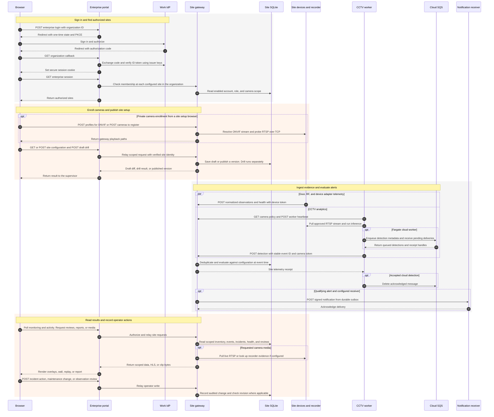

# Global View process maps and evaluation

## Product process map

The customer owns site boundaries, device assignments, and the decision to activate alerts. A deployment team configures the first organization, identity provider, and site gateway. An organization admin assigns membership and camera access. A site supervisor commissions devices and publishes site changes. Operators monitor, investigate, and review results within their assigned scope.

```mermaid
flowchart TD
    subgraph access["1 · Get access"]
        provision["Deployment team configures the organization, work sign-in, and site gateway"]
        provision --> invite["Org admin grants site membership, role, and camera access"]
        invite --> signIn["Customer signs in with work account and selects an authorized site"]
    end
    subgraph design["2 · Build the site"]
        draft["Supervisor opens a site configuration draft"]
        draft --> draw["Draw or reshape a perimeter. Name, label, and enable the boundary"]
        draw --> add["Place cameras, doors, RF sensors, or other devices. Name, group, label, and assign them"]
        add --> connect["Register camera feeds on the site network. Enroll adapters using exact device IDs"]
        connect --> coverage["Aim camera sectors. Review overlaps and gaps, then verify coverage on site"]
    end
    subgraph test["3 · Commission and publish"]
        checks["Test feed, health, alert route, and sample events against the draft"]
        checks --> passes{"Setup passes?"}
        passes -->|"Yes"| publish["Review changes and publish a version. Start CCTV rules in Observe"]
        publish --> validate["Verify live telemetry, clip playback, worker heartbeat, and drill notification"]
    end
    subgraph evaluate["4 · Evaluate and tune"]
        review["Review Observe candidates against video. Compare reports by rule and version"]
        review --> compare["Sample footage independently to find misses. Check delay and false alerts"]
        compare --> qualified{"Rule qualified?"}
        qualified -->|"Yes"| advance["Supervisor publishes Create site alerts for the qualified rule"]
    end
    subgraph operate["5 · Monitor and respond"]
        watch["Watch Map, Site list, and camera wall. Triage device health in Posture"]
        watch --> investigate["Open an incident. Replay door, RF, and camera events. Jump to the map or clip"]
        investigate --> resolve["Assign an owner, log actions, hand off or resolve, and export evidence if needed"]
    end
    signIn --> draft
    coverage --> checks
    passes -->|"Fix setup"| add
    validate --> review
    qualified -->|"Tune and re-test"| draft
    advance --> watch
    resolve -->|"Review recurring issues"| review
    classDef stageGate fill:#fff1e8,stroke:#a84d24,color:#301b13;
    class passes,qualified stageGate;
```

- **Access.** The first organization, gateway, and admin are provisioned through deployment configuration. An existing admin can add members and change access in **Posture → Organization accounts**. An operator needs site membership even after a successful work sign-in. [Enterprise sign-in and shared site setup](global-view-monitoring.md#enterprise-sign-in)
- **Setup.** Supervisors draw in Map and can use Site list for device placement by coordinates and accessible review. Device-to-boundary assignment is explicit. Camera sectors depend on bearing, horizontal field of view, and estimated range. Site-wide health, live playback, recorder coverage, and analytics status each need their own check. [Configuration and appliance testing](global-view-monitoring.md#configuration-workflows)
- **Commissioning.** Save the draft, inspect its diff, run a configuration drill, and publish with a version note. **Test alert route** runs a simulation. Use approved real telemetry, a recorder check, and a configured commissioning webhook to prove the installed path. Use **Restore as a new version** if an earlier configuration is needed. [Publishing and commissioning](global-view-monitoring.md#publish-site-configuration-and-run-always-on-alerts)
- **Evaluation.** The Observe-to-Alert decision is a supervisor operating step. Start CCTV in Observe, choose Cloud or On-premises, review candidates and independent footage, then promote only qualified rules. A report summarizes received evidence. Independent footage supplies the reference events required to count misses. [CCTV pilot workflow and qualification](cctv-analytics.md#pilot-workflow)
- **Operations.** Use the same site workspace for cameras, Posture, incident replay, and shared actions. If a clip is unavailable, review the event and recording status. Schedule maintenance in Posture and use the readiness checks to assess devices and affected boundaries. [Investigate and replay](global-view-monitoring.md#investigate-an-alert) · [Site readiness and recording continuity](global-view-monitoring.md#site-readiness-dispatch-and-recorder-continuity)

## Technical process map

The public HTTPS portal authenticates browser users and relays allowlisted requests to the selected private site gateway. The site gateway owns published configuration, telemetry, and incident state. Media and analytics have distinct paths. The Fargate path below is scaffolded for deployment. The on-premises worker sends to the same gateway API.

See the [camera-to-incident process map](cctv-camera-to-incident.md) for legacy camera ingestion, inference quality gates, and incident evidence storage.

### Request and ownership reference

Browser site requests below are same-origin under `/api/enterprise/orgs/{org}/sites/{site}/`. The portal strips that prefix and supplies its server-held gateway credential and verified identity context. Adapters, the CCTV worker, and the private camera setup path call the site gateway directly using their own authorization.

| Flow | Requests and owner |
| --- | --- |
| Sign-in and accounts | Browser → portal `POST /api/enterprise/login`, `GET /api/enterprise/callback/{org}`, `GET /api/enterprise/session`, and `POST /api/enterprise/logout`. The portal verifies the work IdP response and keeps sessions in its own SQLite database. It checks site memberships with `GET /api/site/session`. Site admins manage members with `GET/POST /api/site/accounts`. The gateway enforces active membership and camera scope for its data and media. [Portal routes](../services/camera-gateway/enterprise_portal.py#L308) · [Gateway account checks](../services/camera-gateway/site_accounts.py#L101) |
| Draft and commissioning | Portal → gateway `GET/POST /api/site/configuration`, `POST /api/site/configuration/preview`, and `POST /api/site/commissioning-test`. Save, publish, discard, and restore use the same configuration endpoint with revision checks. A drill returns results without inserting live incidents. The optional test notification goes to a separate receiver. [Configuration writes](../services/camera-gateway/site_configuration.py#L221) · [Commissioning handler](../services/camera-gateway/gateway.py#L700) |
| Camera enrollment and media | Site setup browser → gateway `POST /api/profiles` and `POST /api/cameras` using the gateway management credential. These routes are outside the enterprise portal's relay allowlist. For regular viewing, browser → portal → gateway `GET /streams/{key}/index.m3u8` and segment requests, with a grid variant. The gateway retains upstream camera credentials and relays HLS. Replay requests `GET /streams/{key}/recording.json` and available MP4 clips. Recorder recovery and XProtect playback need their respective connectors. [Setup client](../desktop-app/src/features/monitoring/cameraGateway.ts#L40) · [Portal allowlist](../services/camera-gateway/enterprise_portal.py#L378) · [Gateway media routes](../services/camera-gateway/gateway.py#L39) |
| Telemetry and incidents | Adapters → gateway `POST /api/site/telemetry` with a device-specific token, source event ID, occurrence time, and observation or health data. The gateway stores accepted telemetry and evaluates eligible events against the published version active at occurrence time. It can link eligible door and camera events, and enqueue a signed notification with a stable delivery ID. These writes and notification retries run with browsers closed. RF reports can appear in replay through the normalized telemetry path. [Telemetry write](../services/camera-gateway/site_telemetry.py#L69) · [Incident evaluation](../services/camera-gateway/site_monitoring.py#L168) · [Notification retries](../services/camera-gateway/gateway.py#L350) |
| Analytics | Worker → gateway `GET/POST /api/cameras/{id}/analytics` for policy and heartbeat, and `POST /api/site/telemetry` for detections. The worker fetches the camera or recorder stream directly. Fargate uses an encrypted queue per camera for detection metadata with temporary task-local staging during queue loss. On-premises uses a local SQLite outbox. Active placement and policy version are validated. Observe and replay are available for review without creating CCTV alerts. The worker stops pulling video if its policy lease expires. [Worker lifecycle](../services/camera-gateway/analytics_worker.py#L238) · [Cloud deployment](../infra/ecs-cctv/README.md#growth-and-recovery) |
| Operator results | Browser → portal → gateway `GET /api/site/monitoring` and `GET /api/site/activity` on a roughly three-second steady-state poll. Use `POST /api/site/incident` and `POST /api/site/maintenance` for shared response actions. `GET/POST /api/site/analytics-review` reads or records review decisions, and `GET /api/site/analytics-report` summarizes candidates by rule, source, profile, and version. The browser renders overlays. Its basemap independently requests map tiles and labels. [Browser polling](../desktop-app/src/features/monitoring/SiteOperator.tsx#L153) · [Gateway reviews](../services/camera-gateway/analytics_review.py#L31) · [Basemap sources](../desktop-app/src/lib/satelliteMapStyle.ts) |

The sequence omits repeated HTTP replies. A cloud message is also deleted after a deliberate gateway validation rejection. A transient delivery failure is retried. An event arriving outside the correlation and notification time allowance can still be available for review. [Worker delivery loop](../services/camera-gateway/analytics_worker.py#L332) · [Occurrence-time handling](../services/camera-gateway/site_monitoring.py#L196)

## Evaluation

### Product process

| Priority | Finding | Improvement and acceptance check |
| --- | --- | --- |
| First pilot | **Getting access and adding the first device require deployment help.** Work sign-in and scoped membership are available. Initial organization and gateway setup is manual. Camera registration requires private gateway reachability and a management credential. | Give the customer a single commissioning checklist with an accountable site contact. Show when access, gateway reachability, feed, telemetry, and the first publish are complete. For a repeatable rollout, pilot a scoped enrollment path for supervisors. Verify that a new admin can onboard a supervisor and that a second organization's account sees none of the site's resources. |
| First pilot | **A visible camera sector and a passing test can overstate readiness.** The camera overlay models horizontal geometry and excludes occlusion, tilt, and health. A simulated alert tests draft routing. | Pair geometry with a field-of-view verification date and distinct live feed, recorder, health, and telemetry checks. Walk the critical boundary, trigger a real test observation, and confirm the correct device, boundary, event timestamp, recording, and drill notification receipt. |
| First pilot | **Observe provides a review queue. Rule acceptance still depends on the supervisor.** Candidate review measures how often received detections are valid. Independently labeled samples are needed for recall and false alarms per camera-hour. | Agree on acceptance thresholds with the customer. Track precision among verified candidates, recall against independently labeled events, false alarms per camera-hour, end-to-end time to incident, and clip availability. Record the version, stream, and model tested. Qualify again after a material change to camera aim, crop, or model. |
| During pilot | **Investigations depend on source timestamps and evidence coverage.** The timeline can bring door, RF, and CCTV evidence together when their inputs are available. A recorder gap can leave only the source event. | Test a normal handoff and a missing-clip case with two operators, including keyboard navigation and Site list. Measure time from opening the incident to reaching usable evidence, completing the handoff, and recording the disposition. |

### Technical process

| Priority | Finding | Improvement and acceptance check |
| --- | --- | --- |
| First pilot | **The site gateway is the main availability boundary.** Local ingest and evaluation keep running through a WAN interruption if site devices and the gateway remain reachable. Gateway or disk loss interrupts acceptance and threatens site records. | Instrument last-good telemetry and delivery backlog. Test gateway restart with the portal closed, then restore the database and camera registry from backup. Confirm data-loss and recovery-time targets with the customer and surface stale site data in the portal. |
| First pilot | **Cloud buffering starts after inference.** Queued metadata survives a task replacement after SQS acknowledges it. During a queue outage, events in task-local staging can be lost on replacement. During loss of the stream or the policy lease, there can be a detection gap. | Run an AWS Observe pilot with two sites. Test worker replacement, gateway outage, SQS interruption, and network recovery. Compare source observation IDs with accepted gateway IDs, verify zero cross-site deliveries and duplicate incidents, and measure unrecoverable gaps. Display video interruption and delivery backlog separately. |
| Before expansion | **Live wall and polling use the same portal-to-site path.** HLS segments and clips transit the portal alongside API calls. The monitoring endpoint can return refreshed snapshots when its cursors change. Login checks site membership across configured gateways. | Load-test concurrent wall viewers, incident polling, and site selection with the expected camera and site counts. Measure gateway and portal CPU, egress, and tail latency. Use the measured bottleneck to decide whether to change polling, proxy/media capacity, or membership lookup. |
| Before expanding evidence retention | **Event windows and retries have operational limits.** The raw telemetry feed retains 10,000 recent events. Monitoring returns bounded recent sets and recorder recovery is optional. Delayed arrivals can miss the live notification window. | Write the site's evidence retention and incident retrieval targets. Verify deduplication, older clip lookup, and explicit missing-evidence states after WAN lag or recorder loss. Size any approved archive and batch replay independently of live inference. |

The next acceptance run should begin with a new organization and finish with two operators reviewing and resolving an event generated with their browsers closed. Include an unauthorized organization, a missing recording, and a temporary disconnect. Existing local tests cover enterprise isolation, direct RTSP/ONVIF wall playback, always-on alerts, and cloud/on-premises policy selection as individual fixtures. The complete customer onboarding path and AWS recovery still need a connected pilot. [Enterprise isolation test](../desktop-app/tests/e2e/enterprise-sign-in.spec.ts) · [Camera and shared operation tests](../desktop-app/tests/e2e/camera-gateway.spec.ts) · [Compute placement test](../desktop-app/tests/e2e/cctv-analytics.spec.ts)
